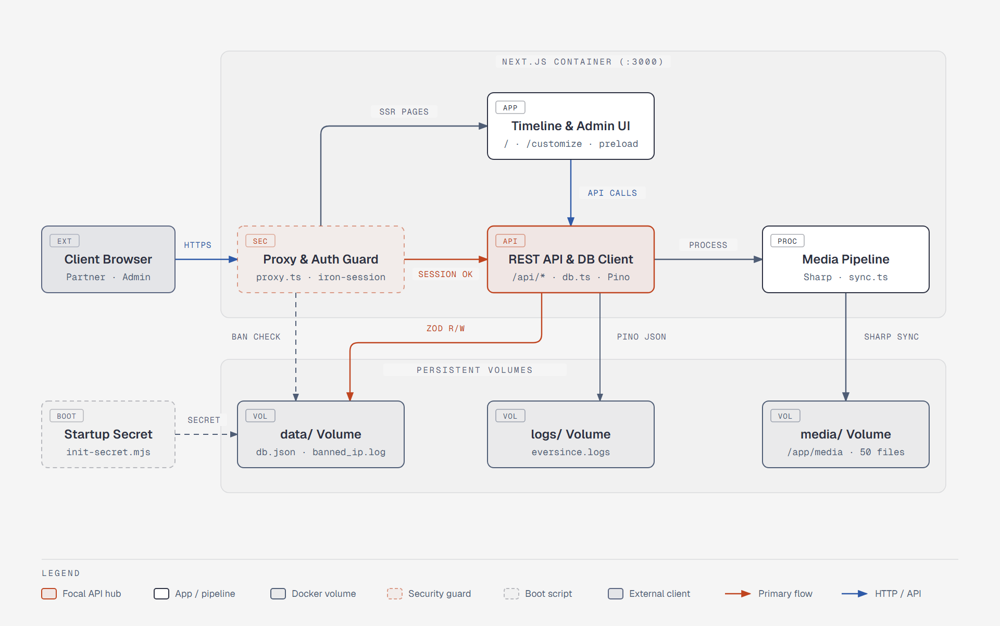

# ever-since
> Ever since we met... A romantic web experience for couples' recurrences, like anniversaries. Customize the experience, upload your photos and videos, and maybe you'll impress them :)

You can see a demo of the user experience from mobile there: [demo](docs/assets/eversince_demo.mp4)

https://github.com/user-attachments/assets/2d5beaef-9a0f-4ae8-bd67-a57aa10e5f66


## Getting Started
Requirements: Node.js 22 and npm.

If you want to try it:
 
```bash
cd ever-since
npm ci
npm run dev
```

Then open <http://localhost:3000>. The login secret is generated on startup and printed in the logs. 


For deployment docker is suggested:
```bash
docker build -t ever-since .

docker run -d \
  -p 3000:3000 \
  -v "$(pwd)/ever-since/data:/app/data" \
  -v "$(pwd)/ever-since/media:/app/media" \
  -v ever-since-logs:/app/logs \
  --name ever-since-app \
  ever-since
```


## What is it?

Ever-Since is a private, self-hosted web app that reveals a linear flow of memories (a header, a text, and a photo or video) to your partner, one card at a time. One person sets everything up from a simple admin page, the other swipes through the story.

It is built to be customizable, extendable, mobile first, with non-technical users in mind.

### Features
- Playful lock screen
- Swipe left/right to see one memory at time, you can add a heading and text if you want
- Photos and videos uploading, you can also upload them into a folder the app will seamlessingly integrate them
- Protected by back-end generated password, persistent session with cookies. Please do not keep the app up for more than required.
- You can deploy with a Dockerfile

To add photos, videos and memories go to `/customize` and you'll find the customization section.
- Add, remove, and drag-to-reorder memories (up to 50).
- Media library split into Photos and Videos, with counts, previews, delete actions, and a marker for unused media (up to 50 files).
- Interactive photo framing (position and zoom) and video volume control.
- Upload files directly into the media/ folder: they are reconciled with the database on login and on customize.

## Tech Stack
| Area | Choice |
| --- | --- |
| Framework | Next.js, React |
| Language | TypeScript (strict), run with `tsx` for scripts |
| Styling and motion | Tailwind CSS, Framer Motion  |
| Data storage | flat JSON database (`db.json`) with Zod validation, media on the local filesystem |
| Image processing | Sharp (resize to 2048px max, EXIF stripping) |
| Auth and security | App-generated 20-character secret, encrypted cookie sessions with `iron-session`, constant-time comparison, persistent IP ban list |
| Logging | `pino` (structured JSON logs, backend only) |
| Code quality | ESLint (`eslint-config-next`), `simple-git-hooks`, GitHub Actions CI, automated tests under `tests/` |
| Infra | Docker multi-stage build (deps, build, runtime) on `node:22-alpine`, non-root user, persistent volumes for `data/`, `media/` and `logs/` |

## Architecture
> Diagram made with Diagram Design skill


 

## Documentation
 
| Topic | File |
| --- | --- |
| PRD | [docs/requirements.md](docs/requirements.md) |
| Architecture and APIs | [docs/architecture.md](docs/architecture.md) |
| Setup | [docs/init.md](docs/init.md) |
| Design, UI and UX | [docs/design.md](docs/design.md) |
| Testing | [docs/testing.md](docs/testing.md) |


## Privacy and security consideration
 
Ever-Since handles personal data, so it is designed to be **temporary**. I personally run it for a few days around the anniversary and then shut it down. The app was developed with web app security in mind but it is not perfect. A basic login rate limited with IP ban for failed attempts is implemented but it may be not enough so be careful.

